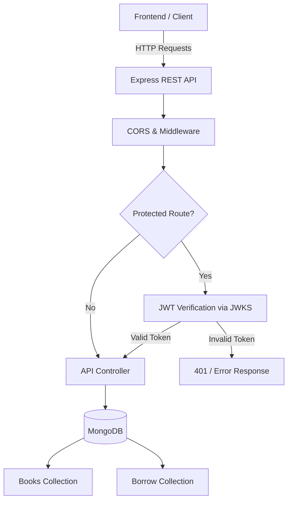

# 📚 Book Nook — Backend API

<p align="center">   <strong>A secure REST API powering the Book Nook book-sharing platform.</strong> </p>

<p align="center">   <a href="https://book-nook-seven.vercel.app/">        </a>   <a href="https://book-nook-server-orpin.vercel.app/">        </a>   <a href="https://github.com/fuyad254/Book-Nook">        </a>   <a href="https://github.com/fuyad254/Book-Nook-Server">        </a> </p>

---

## 🌟 About

**Book Nook Backend** is the REST API for the Book Nook application, a community-driven book-sharing platform.

Built with Node.js, Express, and MongoDB, it handles book management, borrowing operations, user-specific collections, and secure access to protected resources using JWT authentication.

## ✨ Features

- 📚 Retrieve all books from the library
- 🔍 Fetch individual book details
- 🆕 Get the latest added books
- ➕ Add new books
- ✏️ Update existing book information
- 🗑️ Delete books
- 👤 Retrieve books belonging to a user
- 🤝 Manage borrowing records
- 📥 Borrow and return books
- 🔐 JWT authentication and verification
- 🛡️ Protected endpoints
- 🍃 MongoDB database integration
- 🔄 Prevent duplicate borrowing records

## 🌐 Live API

| Resource                | URL                                                                |
| ----------------------- | ------------------------------------------------------------------ |
| 🚀 Backend API          | [Book Nook Server](https://book-nook-server-orpin.vercel.app/)     |
| 💻 Frontend Application | [Book Nook](https://book-nook-seven.vercel.app/)                   |
| 🖥️ Frontend Source     | [Frontend Repository](https://github.com/fuyad254/Book-Nook)       |
| ⚙️ Backend Source       | [Backend Repository](https://github.com/fuyad254/Book-Nook-Server) |

## 🛠️ Tech Stack

<p align="center">             </p>

| Technology | Purpose                            |
| ---------- | ---------------------------------- |
| Node.js    | JavaScript runtime                 |
| Express.js | REST API framework                 |
| MongoDB    | NoSQL database                     |
| CORS       | Cross-origin resource sharing      |
| dotenv     | Environment variable configuration |
| jose       | JWT verification and JWKS support  |

## 🏗️ Architecture



## 📡 API Endpoints

### 📚 Books

| Method   | Endpoint        | Description        | Auth |
| -------- | --------------- | ------------------ | ---- |
| `GET`    | `/books`        | Get all books      | ❌    |
| `GET`    | `/book/:id`     | Get a book by ID   | ✅    |
| `GET`    | `/latest-books` | Get latest 6 books | ❌    |
| `POST`   | `/add-book`     | Add a new book     | ✅    |
| `PATCH`  | `/my-books/:id` | Update a book      | ✅    |
| `DELETE` | `/my-books/:id` | Delete a book      | ❌    |

### 👤 User Books

| Method | Endpoint           | Description             | Auth |
| ------ | ------------------ | ----------------------- | ---- |
| `GET`  | `/my-books/:email` | Get books by user email | ✅    |

### 🤝 Borrowing

| Method   | Endpoint                | Description                    | Auth |
| -------- | ----------------------- | ------------------------------ | ---- |
| `GET`    | `/borrows/:email`       | Get a user's borrowed books    | ✅    |
| `POST`   | `/my-borrow`            | Create a borrow record         | ❌    |
| `PATCH`  | `/my-borrow/:id`        | Decrease book copies           | ❌    |
| `PATCH`  | `/my-borrow-return/:id` | Increase book copies on return | ❌    |
| `DELETE` | `/my-borrow/:id`        | Remove a borrow record         | ❌    |

> **Auth:** Protected endpoints require a valid JWT Bearer token in the `Authorization` header.

## 🔐 Authentication

Protected routes use JWT verification powered by **Better Auth's JWKS endpoint**.

The backend retrieves the public signing keys from the frontend authentication server and verifies incoming tokens using the `jose` library.

Example request header:

```http
Authorization: Bearer <your_jwt_token>
```

## 🍃 Database

Book Nook uses MongoDB with the following collections:

| Collection | Description                             |
| ---------- | --------------------------------------- |
| `book`     | Stores book information and book copies |
| `borrow`   | Stores borrowing records                |

A unique compound index on `userEmail` and `bookId` helps prevent a user from borrowing the same book more than once.

## 🚀 Getting Started

### Prerequisites

- [Node.js](https://nodejs.org/) installed
- npm
- MongoDB database
- Git

### 1️⃣ Clone the repository

```bash
git clone https://github.com/fuyad254/Book-Nook-Server.git
cd Book-Nook-Server
```

### 2️⃣ Install dependencies

```bash
npm install
```
### 3️⃣ Environment configuration

Create a `.env` file in the root directory:

```env
MONGODB_URI=your-mongodb-connection-string
CLIENT_URL=http://localhost:3000
```

| Variable      | Description                                               |
| ------------- | --------------------------------------------------------- |
| `MONGODB_URI` | MongoDB connection string                                 |
| `CLIENT_URL`  | Frontend/auth server URL used for JWKS token verification |

> ⚠️ Keep your environment variables private. Never upload your `.env` file or credentials to GitHub.

### 4️⃣ Start the server

```bash
node index.js
```

The backend server runs at:

```
http://localhost:5000
```

To verify the server is running, open the URL above. You should receive:

```
Book Nook Server is Running Successfully!
```
## 📂 Project Structure

```
Book-Nook-Server/
├── index.js
├── package.json
├── package-lock.json
├── vercel.json
├── .gitignore
└── .env
```

## 🔒 Security & Validation

- JWT authentication for protected endpoints
- JWKS-based public key verification
- CORS enabled for client communication
- Duplicate borrowing prevention
- Environment variables for sensitive configuration
- MongoDB unique index for borrow records

## 👨‍💻 Author

**Fuyad**
Frontend Developer | Full-Stack Developer

<p align="center">   ⭐ If you find this project useful, consider giving it a star! </p>

---

<p align="center">   \<strong>Built with ❤️ to make sharing books easier.\</strong> </p>
